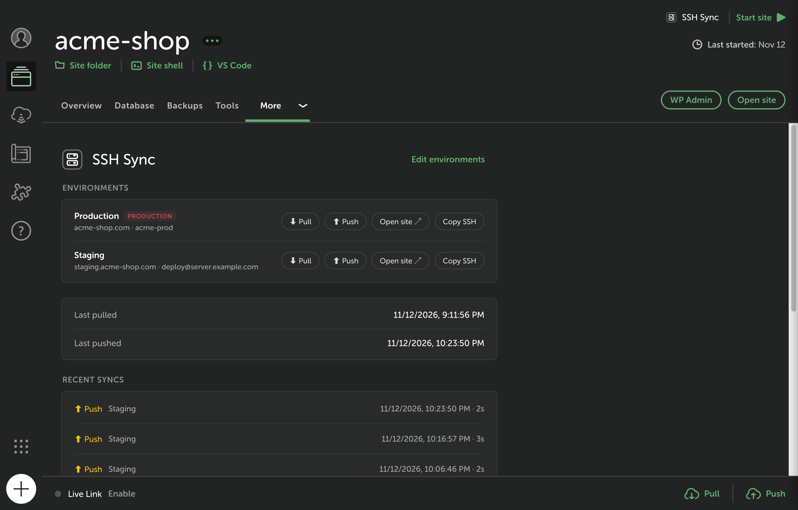
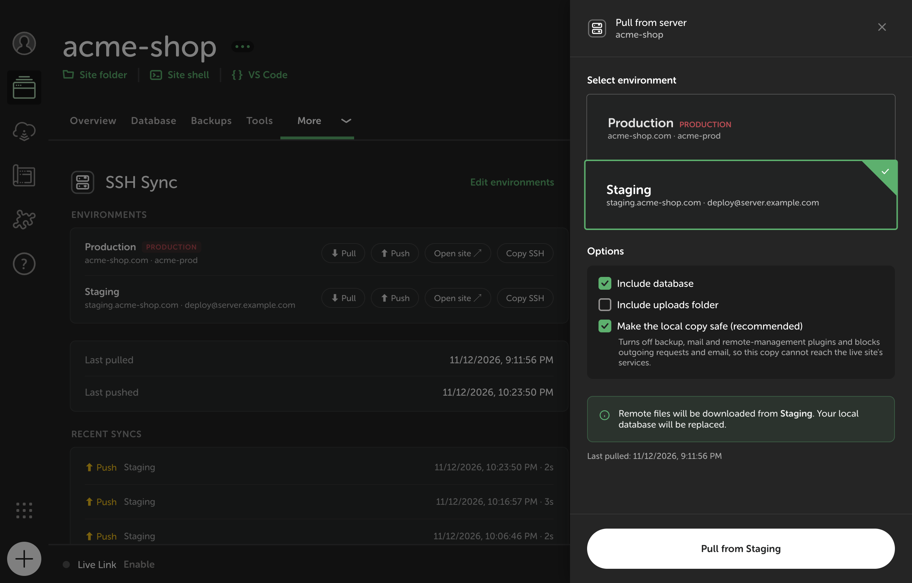
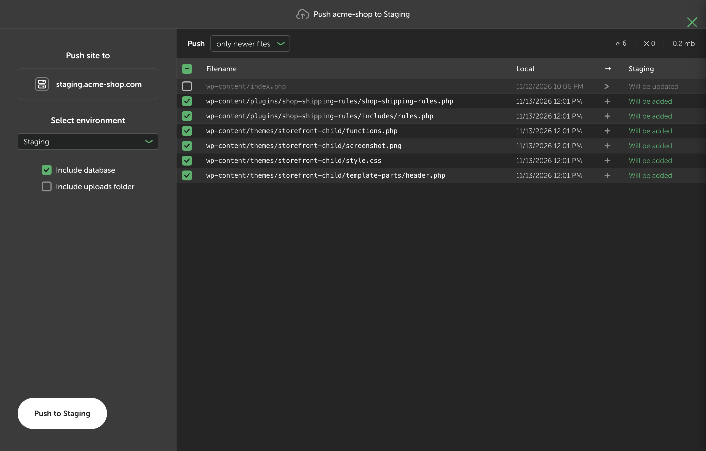
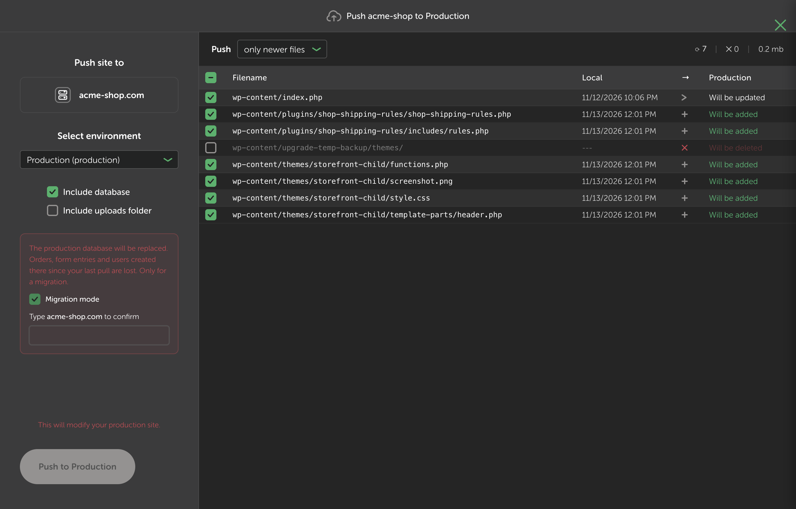

<p align="center">
  
</p>

<h1 align="center">SSH Sync for Local</h1>

<p align="center">
  <strong>Pull and push WordPress sites between <a href="https://localwp.com">Local</a> and any server you can SSH into.</strong><br>
  Files and database, with a preview of every change, an undo for every push, and a local copy that can't email your customers.
</p>

<p align="center">
  <a href="https://github.com/fabiomsnunes/local-addon-ssh-sync/releases/latest"></a>
  <a href="https://github.com/fabiomsnunes/local-addon-ssh-sync/actions/workflows/ci.yml"></a>
  
  
  <a href="LICENSE"></a>
</p>

<p align="center">
  <a href="#install">Install</a> ·
  <a href="#quick-start">Quick start</a> ·
  <a href="#features">Features</a> ·
  <a href="#command-line">Command line</a> ·
  <a href="#faq">FAQ</a>
</p>

https://github.com/user-attachments/assets/ea0b8deb-49ef-43ab-aa7e-160ea08cd673

## Why

Local's one-click Connect only talks to WP Engine and Flywheel. Everyone else (a VPS, a cPanel host, a managed host, a client's own server) ends up juggling `rsync`, `mysqldump`, `wp search-replace` and a migration plugin, and hoping nothing goes wrong on the live site.

SSH Sync brings that one-click flow to **any host**. No API keys, no account, no plugin on the server: if `ssh you@your-server` works, SSH Sync works.

## Use cases

- **Work on a live site locally.** Pull files and database in one click, URLs rewritten, ready to open.
- **Ship your changes.** Push only the files you touched to staging, check them, then to production.
- **Debug a client site safely.** The local copy can't send emails, run backups or charge cards.
- **Move a site to a new server.** Pull from the old host, push everything to the new one in Migration mode.

## Features

### One place for every environment

Production, staging, a test server: add as many as you need per site. Each has its own SSH connection, WordPress folder, URL, WP-CLI command and cache command. Pick a host from your `~/.ssh/config` or type it in; log in with your SSH key or a password kept in the macOS Keychain.



### Pull with a safe local copy

Pull files (uploads optional) and the database. URLs are rewritten everywhere, serialized data and JSON included, and table prefix differences are handled for you.

A pulled site runs the live site's plugins, and the first page you open fires wp-cron. **Make the local copy safe** (on by default) blocks outgoing email and HTTP, turns off backup, mail and remote-management plugins, and switches Stripe to test mode, so your copy can't upload a backup to the live site's storage or email a customer. When you later push the database, everything it turned off is turned back on on the server.



### Push exactly what you mean to

Before anything moves, the preview lists every file that would be added, updated or deleted on the server. Push _only newer_ files or _all modified_ ones, untick what you don't want, and nothing is ever deleted on the server unless you tick it.



### Production has guard rails

- Production is marked and asks for confirmation.
- Replacing a production database needs **Migration mode** and the domain typed back.
- If the server's own site URL doesn't match the environment, the sync stops and tells you.
- Only one push at a time per server folder, across computers and people.



### Every push can be undone

Each push keeps, on your computer, the files it replaced or deleted and the database from right before it. **Undo last push** puts them back and removes the files it added. If anything changed on the server since, or someone pushed after you, undo stops and tells you what.

If a push fails halfway, it rolls itself back: database and files.

### Command line

The same engine and the same guards, from the terminal. See [Command line](#command-line).

## How it compares

|                                         | SSH Sync |        Local Connect        | Migration plugins | rsync + WP-CLI by hand |
| --------------------------------------- | :------: | :-------------------------: | :---------------: | :--------------------: |
| Any host with SSH                       |    ✅    | WP Engine and Flywheel only |        ✅         |           ✅           |
| Nothing to install on the server        |    ✅    |             ✅              |        ❌         |           ✅           |
| Preview of every file before a push     |    ✅    |             ✅              |         –         |      `--dry-run`       |
| Undo a push                             |    ✅    |             ❌              |         –         |           ❌           |
| Local copy can't email or charge anyone |    ✅    |             ❌              |        ❌         |           ❌           |
| Inside Local, one click                 |    ✅    |             ✅              |        ❌         |           ❌           |

## Install

1. Download `local-addon-ssh-sync-<version>.tgz` from the [latest release](https://github.com/fabiomsnunes/local-addon-ssh-sync/releases/latest).
2. In Local: **Add-ons → Installed → Install from disk**, and pick the file.
3. Enable the add-on and relaunch Local when it asks.

**Requirements**

- **Local 10** or newer, on **macOS**. Linux should work but is untested; Windows is not supported.
- **On the server:** SSH access, `rsync` and [WP-CLI](https://wp-cli.org/). Most hosts have both, and **Test connection** tells you if one is missing.
- **On your Mac (recommended):** `brew install rsync`. The rsync macOS ships works, but can't show live progress or file sizes in the preview.

## Quick start

1. Create or open the site in Local. For a new copy of a live site, an empty WordPress site is enough.
2. Open **More → SSH Sync → Add a server**:
   - **Connection:** a host from your `~/.ssh/config`, or host, user and port
   - **Authentication:** SSH key or password
   - **WordPress folder:** where `wp-config.php` lives, e.g. `/var/www/example.com` or `~/public_html`
   - **Site URL:** e.g. `https://example.com`
   - **This is production:** tick it for the live site
3. **Test connection**, then **Save**.
4. **Pull** to bring the site into Local. **Push** to send your changes back.

## Under the hood

<details>
<summary><strong>What a pull and a push do, step by step</strong></summary>

**Pull** (server → Local): connect once and check the WordPress folder → install the local safety net → rsync files → back up the local database → export the server database to a private temp file, download it and delete it → import → search-replace → adopt the server's table prefix → make the copy safe.

**Push** (Local → server): the preview shows exactly what would change. Then: confirmation for production → lock the server folder → (with the database) export the server database as the rollback backup → rsync only the files you selected, keeping what they replace → delete only the deletions you ticked → (with the database) import, search-replace, and re-enable what the safe copy turned off → run the environment's cache command → keep everything needed to undo it.

**Never synced, either way:** `wp-config.php` and every copy of it, `.htaccess`, `.user.ini`, `php.ini`, object and page cache drop-ins, `wp-content/cache/`, `.git`, `node_modules`, SQL dumps, backup copies of any file (`*.bak`, `*.orig`, `*~`) and the safety mu-plugin. Add your own per environment (e.g. `wp-content/litespeed/`).

</details>

<details>
<summary><strong>What exactly the safe local copy changes</strong></summary>

With **Make the local copy safe** on, every pull:

- installs `wp-content/mu-plugins/ssh-sync-local-safety.php` and defines `SSH_SYNC_LOCAL_COPY` in the Local site's `wp-config.php` _before_ anything is transferred: outgoing HTTP is blocked (WordPress.org and local hosts allowed) and no email is sent;
- deactivates backup, mail, remote-management and alerting plugins (UpdraftPlus, BackWPup, MainWP Child, ManageWP Worker, FluentSMTP, WP Mail SMTP, Post SMTP, MailPoet, Wordfence, …) straight in the database, before WordPress loads;
- switches WooCommerce Stripe to test mode;
- sets `WP_ENVIRONMENT_TYPE` to `local`.

The mu-plugin is never pushed. When you push the database to the server you pulled from, SSH Sync turns back on exactly what it turned off, so the live site never ends up without its backups or payments. Delete the mu-plugin or the `SSH_SYNC_LOCAL_COPY` line to turn the protection off on a copy.

</details>

## Command line

Install it with **Install ssh-sync**, in the Command line section of a site's SSH Sync page. It lands next to Local's own `localwp` command (**Preferences → Advanced → Install Local CLI** puts that folder on your `PATH`). Local must be running.

```bash
ssh-sync envs my-site                        # list environments
ssh-sync test my-site staging                # test the connection
ssh-sync pull my-site production             # files + database, safe copy
ssh-sync pull my-site production --no-db --uploads
ssh-sync push my-site staging                # dry run: lists what would change
ssh-sync push my-site staging --yes          # push the listed files
ssh-sync push my-site staging --yes --db     # and the database
ssh-sync undo my-site staging --yes          # undo the last push
```

`push` never deletes on the server without `--delete`, pushing to production needs `--production`, and the command line never replaces a production database: that takes Migration mode in the app.

## Security

- **Your keys and passwords stay safe.** SSH keys stay in your agent and `~/.ssh/config`. Passwords are encrypted in the macOS Keychain and reach ssh through a one-shot socket, never in process arguments, environment variables or files.
- **Nothing left on the server.** Database dumps go to private temporary files and are deleted right after the transfer. Push backups stay on your computer (last 3 per environment).
- **No shell strings, no telemetry.** Every command runs with argument arrays and every value sent to the server is validated and quoted. SSH Sync talks to your servers and nothing else.

Found a vulnerability? See [SECURITY.md](SECURITY.md).

## FAQ

**Does it work with my host?**
If you can open a terminal and `ssh` into the server, and the server has `rsync` and WP-CLI, yes. That covers most VPSs, cPanel and Plesk hosts with SSH enabled, and managed WordPress hosts with SSH access. **Test connection** checks all of it before the first sync.

**My host only allows passwords, not keys.**
Pick **Password** under Authentication. It's stored in the macOS Keychain and never passed on the command line.

**Will a pull touch my live site?**
It doesn't change it. A pull only reads from the server: it exports the database to a temporary file in your SSH user's home, downloads it and deletes it.

**I pushed the wrong thing.**
Open the site's SSH Sync page and click **Undo last push**. It restores the files and the database from right before that push, as long as nothing changed on the server since.

**Can I use it with Bedrock, a custom `wp-content` or multisite?**
Multisite and custom table prefixes are handled. Non-standard layouts like Bedrock are not tested yet: [open an issue](https://github.com/fabiomsnunes/local-addon-ssh-sync/issues) with your setup.

**Windows?**
Not yet: SSH Sync relies on the `ssh` and `rsync` a Mac has. Contributions welcome.

## Troubleshooting

| Problem                                            | Fix                                                                                                                          |
| -------------------------------------------------- | ---------------------------------------------------------------------------------------------------------------------------- |
| Test connection: "Could not connect … over SSH"    | Try `ssh <target>` in a terminal. With a key, it must be in your agent or `~/.ssh/config` (no passphrase prompt is possible) |
| "The WordPress folder … does not exist"            | Use the folder that holds `wp-config.php`; `~/` is the SSH user's home                                                       |
| "WP-CLI failed"                                    | Set the WP-CLI command, e.g. `php ~/wp-cli.phar` or `php8.2 /usr/local/bin/wp`                                               |
| "rsync is not installed on the server"             | Ask your host; SSH Sync needs it to transfer files                                                                           |
| No live progress, preview without sizes            | `brew install rsync`                                                                                                         |
| "The local site must be running for database sync" | Start the site in Local first                                                                                                |
| "N file(s) were skipped" after a sync              | File names in a legacy encoding that macOS can't store; rename them on the server                                            |

## Contributing

Bug reports, ideas and pull requests are welcome. Start with [CONTRIBUTING.md](CONTRIBUTING.md); architecture notes and what we learned about Local's add-on API are in [CLAUDE.md](CLAUDE.md).

```bash
npm install
npm run build          # main + renderer
npm run watch          # rebuild on change (renderer hot-reloads; main needs a Local restart)
npm test
```

## Credits

Built and maintained by [Fábio Nunes](https://github.com/fabiomsnunes) at [WPlus](https://wplus.pt), a WordPress agency in Portugal.

Started from [local-addon-kinsta](https://github.com/landerss0n/local-addon-kinsta) by Lucas Andersson (MIT), whose sync engine it reuses for any host. Not affiliated with WP Engine, Local or Kinsta.

## License

[MIT](LICENSE)
